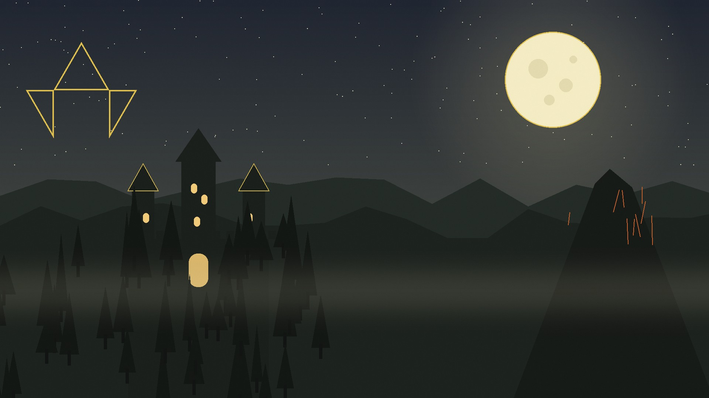

# Zelda: Ocarina of Time — Discord Theme (Vencord / BetterDiscord)

Ein Theme im Look von **The Legend of Zelda: Ocarina of Time** (N64, 1998):
Gold, Waldgrün und Schwarz, ein selbst gezeichnetes **Hyrule-Hintergrundbild**
und goldene Akzente (Message-Bar, Triforce bei Erwähnungen, Noten-UI).



## Installation

**Vencord**
1. Vencord → Einstellungen → Themes → **Themes-Ordner öffnen**
   (Windows: `%appdata%\Vencord\themes`)
2. `ZeldaOcarina.theme.css` **und** `zelda-bg.jpg` in diesen Ordner kopieren
   (beide Dateien müssen zusammen bleiben – das Bild wird relativ geladen)
3. Themes neu laden (`Strg+R`) und **Zelda — Ocarina of Time** aktivieren

**BetterDiscord**
Gleiches Vorgehen: beide Dateien in den Themes-Ordner, dann in den Einstellungen aktivieren.

## Anpassen

Die wichtigsten Werte stehen ganz oben in der CSS-Datei:

```css
--z-bg: url("zelda-bg.jpg");   /* anderes Bild? hier eintragen */
--z-bg-size: cover;            /* cover | contain | 68vmin   */
--z-bg-position: center;       /* center | right center | …  */

/* Panels (halbtransparent, Bild scheint durch) */
--z-panel: rgba(13, 15, 11, 0.66);

--z-gold: #e8c547;
--z-green: #2e6b3e;
```

Das Bild liegt vollflächig hinter der ganzen App (`cover`, `fixed`). Darüber liegen
ein gold-grüner Farbschleier und halbtransparente Panels – das Bild wirkt dadurch
„leicht transparent“ wie in einer Theme-Preview.

## Dateien

| Datei | Zweck |
|---|---|
| `ZeldaOcarina.theme.css` | das Theme |
| `zelda-bg.jpg` | Hyrule-Hintergrundbild (1920×1080) |
| `make-bg.py` | erzeugt das Hintergrundbild neu (Pillow) |
| `preview.html` + `preview.css` | HTML-Vorschau (im Browser öffnen) |
| `preview.png` | Bild für dieses README |
| `install.ps1` | kopiert Theme + Bild in den Vencord-Themes-Ordner (Windows) |

## Lizenz

Theme-CSS und Hintergrundbild frei verwendbar. The Legend of Zelda und alle Figuren
sind Eigentum von Nintendo — inoffizielles Fan-Projekt ohne Verbindung zu Nintendo.
